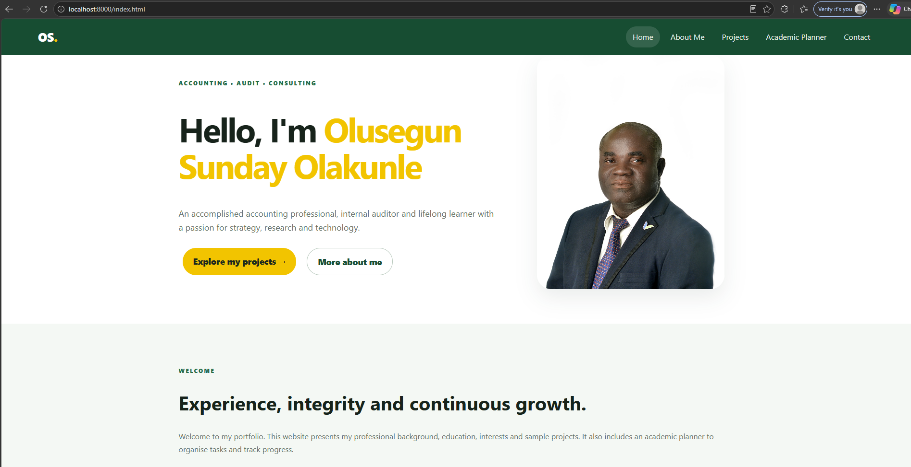
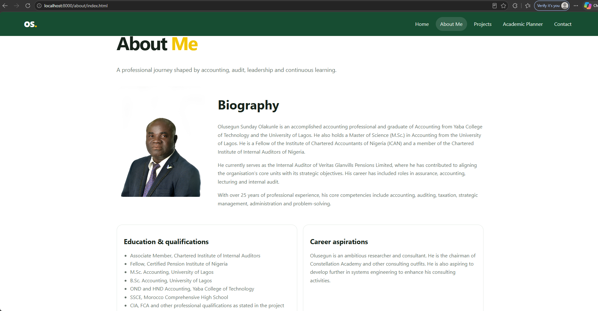
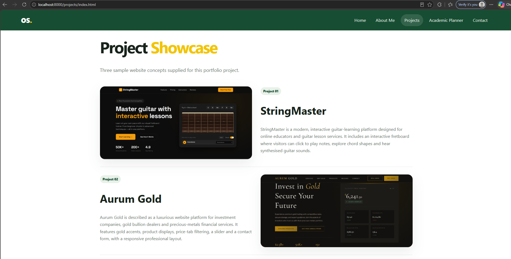
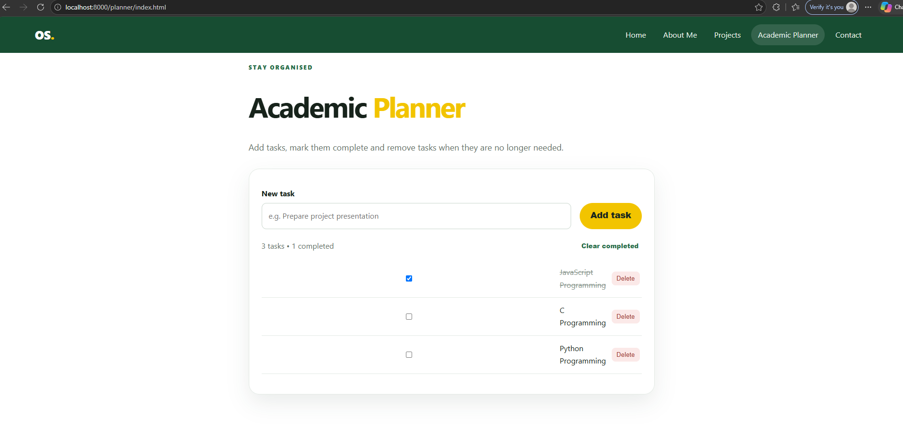
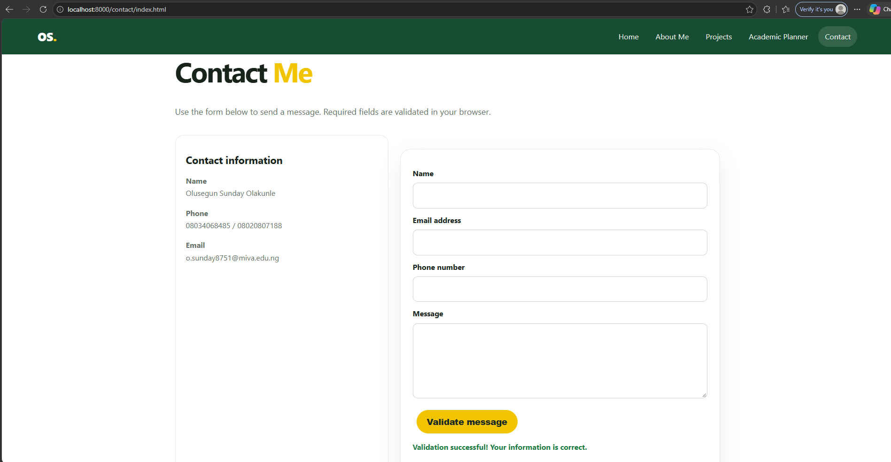
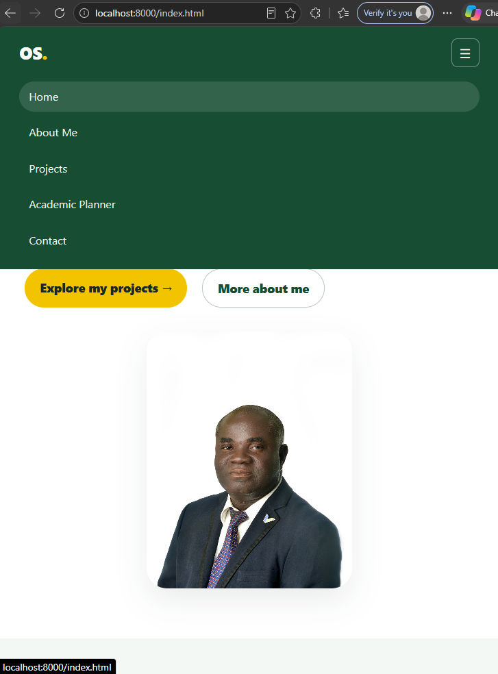

# PROJECT DOCUMENTATION

## Responsive Student Portfolio and Academic Management Website

**Course:** CSC 106 – Introduction to Web Technologies

**Student:** Olusegun Sunday Olakunle

**Email:** o.sunday8751@miva.edu.ng

**Project title:** Design and Develop a Responsive Student Portfolio and Academic Management Website

## 1. Project Overview

### 1.1 Introduction

This is a responsive, multi-page personal portfolio and academic management website. It presents the student's biography, educational background, career aspirations, professional skills, hobbies and sample projects. It also provides an interactive academic planner and a validated contact form.

### 1.2 Purpose and objectives

- Present the student's personal and professional profile.
- Showcase at least three sample projects with descriptions and images.
- Allow users to add, complete and delete academic tasks.
- Provide a contact form with client-side validation.
- Demonstrate practical HTML, CSS and JavaScript skills.

### 1.3 Features

1. Homepage with student name, welcome message, navigation, biography summary and featured projects.
2. About page with educational background, career aspirations, technical/professional skills and interests.
3. Projects page with StringMaster, Aurum Gold and Nimsy Agro Solar Concept.
4. Academic planner with add, complete, delete and clear-completed functions.
5. Contact form with name, email, phone and message validation.
6. Responsive layout, mobile navigation, consistent colours and hover effects.

### 1.4 Technology stack

| Technology | Implementation                                                  |
| ---------- | --------------------------------------------------------------- |
| HTML5      | Semantic structure, headings, lists, links, images and forms    |
| CSS3       | Styling, Flexbox/Grid, responsive media queries and transitions |
| JavaScript | DOM manipulation, event handling, planner logic and validation  |
| Browser    | Runs the client-side application                                |

No framework or database is required by the project brief. The contact form currently validates in the browser only; it does not send messages.

## 2. Website Sections, Screenshots and Explanations

The website has five pages: `index.html`, `about/index.html`, `projects/index.html`, `planner/index.html` and `contact/index.html`. Shared resources are stored under `assets/css`, `assets/js` and `assets/images`.

### 2.1 Homepage

**Screenshot:** 

Introduces Olusegun Sunday Olakunle, displays a welcome message, navigation and featured projects. The portrait is a replaceable placeholder.

**Implementation:** Semantic header, navigation, main and section elements; CSS Grid hero layout; reusable buttons and project cards.

### 2.2 About Me

**Screenshot:** 

Presents the biography, qualifications, career aspirations, professional competencies and interests.

**Implementation:** HTML headings, paragraphs and lists, arranged with CSS Grid.

### 2.3 Projects

**Screenshot:** 

**StringMaster:** A modern interactive guitar-learning platform concept with a visual fretboard, chord exploration and synthesised guitar sounds.

**Aurum Gold:** A luxurious platform for investment companies, gold bullion dealers and precious-metals services. The supplied description mentions gold accents, product displays, price-tab filtering, a slider and contact form.

**Nimsy Agro Solar Concept:** A renewable-energy concept focused on affordable clean energy for agricultural production, including solar-powered irrigation and post-harvest solutions. The supplied description notes the challenges of fuel costs, drought, erratic rainfall and heatwaves for smallholder farmers.

**Implementation:** Each project uses an article-like content block with an image, title, description and responsive layout.

### 2.4 Academic Planner

**Screenshot:** 

Users can add a task, mark it complete, delete it or clear all completed tasks.

**Implementation:** JavaScript stores task objects in an array. `render()` rebuilds the list from the array after changes. Event listeners handle form submission, checkbox changes and delete/clear actions.

### 2.5 Contact Page

**Screenshot:** 

Visitors enter their name, email, phone number and message.

**Implementation:** JavaScript intercepts form submission, checks that all fields are completed, validates the email format and ensures the phone contains digits only. Feedback is displayed on the page.

**Limitation:** This is a front-end demonstration; it does not deliver or store messages. A backend or form-processing service is required for live contact submissions.

### 2.6 Responsive mobile view



Capture the website at a narrow viewport to demonstrate the mobile navigation and single-column layout. CSS media queries adjust the navigation, grids and spacing.

## 3. JavaScript Implementation

### 3.1 Shared navigation — `assets/js/main.js`

The script waits for `DOMContentLoaded`, selects the menu button and navigation, and adds a click listener. The listener toggles the `open` class and updates `aria-expanded`. It also inserts the current year into footer elements.

**Concepts:** DOM selection, event listeners, class manipulation and text updates.

### 3.2 Task planner — `assets/js/planner.js`

Tasks are represented as objects containing an ID, title and completion status in a JavaScript array.

- Add: intercepts form submission, trims the input and pushes a new object into the array.
- Display: the render function loops through the array and creates list elements.
- Complete: a checkbox event updates the task's `completed` property.
- Delete: `filter()` removes the selected task.
- Clear completed: `filter()` retains only incomplete tasks.
- Count: displays total tasks and completed tasks.

**Concepts:** arrays, objects, functions, `forEach`, `filter`, event handling, conditional rendering and DOM manipulation.

**Limitation:** The array exists only in memory. Refreshing the browser clears tasks; local storage or a database would be needed for persistence.

### 3.3 Contact validation — `assets/js/contact.js`

The submit event is intercepted and the input values are trimmed. The script checks for empty fields, a basic email pattern and digits-only phone number, then displays an error or success message.

**Concepts:** event handling, form values, strings, regular expressions, conditional statements and DOM updates.

## 4. Codebase Explanation

### 4.1 Semantic HTML example

```html
<header class="site-header">
  <a class="brand" href="index.html">OS<span>.</span></a>
  <nav class="nav">
    <a href="index.html">Home</a>
    <a href="about/index.html">About Me</a>
    <a href="projects/index.html">Projects</a>
  </nav>
</header>
<main>
  <section class="hero container">
    <h1>Hello, I'm <span>Olusegun Sunday Olakunle</span></h1>
  </section>
</main>
```

Semantic elements communicate the purpose of each page region and make the structure easier to maintain.

### 4.2 Planner add-task logic

```javascript
form.addEventListener("submit", event => {
  event.preventDefault();
  const title = input.value.trim();
  if (!title) return;
  tasks.push({
    id: Date.now() + Math.random(),
    title,
    completed: false
  });
  input.value = "";
  render();
});
```

`preventDefault()` prevents a page reload. The trimmed task is added as an object to the array, then the interface is re-rendered.

### 4.3 Contact validation logic

```javascript
const validEmail = /^[^\s@]+@[^\s@]+\.[^\s@]+$/.test(email);
const digitsOnly = /^\d+$/.test(phone);
```

Regular expressions check a basic email structure and digits-only phone input.

### 4.4 Responsive CSS example

```css
.project-grid {
  display: grid;
  grid-template-columns: repeat(3, 1fr);
}
@media (max-width: 800px) {
  .project-grid { grid-template-columns: 1fr 1fr; }
}
@media (max-width: 560px) {
  .project-grid { grid-template-columns: 1fr; }
}
```

The grid changes from three columns to two and then one as the viewport narrows.

## 5. Testing and Verification

Run these tests in a browser and update the status after performing them.

| Test                      | Expected result                | Status |
| ------------------------- | ------------------------------ | ------ |
| Load homepage             | Page and navigation display    | tested |
| Navigate between pages    | Correct page opens             | tested |
| Resize viewport           | Layout adapts to mobile/tablet | tested |
| Add task                  | Task appears in planner        | tested |
| Complete task             | Task is shown as completed     | tested |
| Delete task               | Selected task disappears       | tested |
| Submit empty contact form | Required-field message appears | tested |
| Invalid email             | Email error appears            | tested |
| Non-digit phone           | Phone error appears            | tested |
| Valid contact details     | Demo success message appears   | tested |

## 6. Project Links

- **Hosted website:** [live-website](https://sundayolakunle1976.github.io/website-portfolio-project/index.html)

- **GitHub repository:** [Website-repo](https://github.com/sundayolakunle1976/website-portfolio-project.git)

These are left blank because no live hosting or repository links were provided.

## 7. Limitations and Future Improvements

1. Add local storage or database persistence for planner tasks.
2. Connect the contact form to a backend or secure form service.

## 8. Conclusion

The project demonstrates the use of HTML, CSS and JavaScript to create a responsive multi-page portfolio and academic management interface. It combines profile presentation, project showcasing, task management and client-side form validation. The report explains how the website is organised, and how its main features work.
